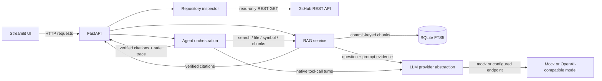

# GitHub Repository Analyzer — RAG & Agentic AI

GitHub Repository Analyzer turns a public repository into a bounded, searchable source snapshot. It combines a FastAPI backend, a Streamlit interface, SQLite FTS5 retrieval, and an optional OpenAI-compatible model provider to explain repository code with commit-pinned citations.

The project explores a practical engineering question: how can an AI assistant answer code questions while keeping repository access read-only, grounding claims in retrieved files, and making its evidence inspectable?

## Highlights

### Repository inspection and analysis

- Reads public GitHub repository metadata, the default-branch commit, and a bounded set of text files through GitHub REST API `GET` requests.
- Displays source files with their blob SHA and inspected commit.
- Summarizes selected repository context with the deterministic mock provider by default, or an explicitly configured OpenAI-compatible provider.

### RAG question answering

- Indexes bounded source snapshots locally in SQLite FTS5 and reuses indexes keyed by repository commit.
- Splits source into overlapping, line-addressable chunks with stable IDs derived from the commit, blob, path, and line range.
- Sends retrieved evidence to the provider and accepts citations only when their chunk IDs were included in that prompt.
- Builds source links on the server, pinned to the inspected commit and exact chunk lines.
- Shows indexed files, retrieved chunks, prompt-included chunks, and citations in the UI.

### Read-only agentic tool calling

- Uses native Chat Completions tool calls in a separate, bounded orchestration service.
- Allows four Pydantic-validated tools: `search_repository`, `read_file`, `find_symbol`, and `retrieve_chunks`.
- Reuses GitHub inspection and the SQLite FTS5 index; it does not execute repository code or shell commands.
- Verifies final evidence IDs against chunks returned during that agent run, then generates pinned citations server-side.
- Limits tool steps, calls, context, and tool response size. Agent mode is disabled unless explicitly enabled.

## Architecture



See [the architecture guide](docs/architecture.md) for the request flows, evidence model, bounds, and security trade-offs. For a short walkthrough, see the [demonstration guide](docs/demo.md).

## Technology

| Technology | Role |
|---|---|
| Python 3.11+ | Application services, schemas, and evaluation tooling |
| FastAPI | HTTP API for inspection, analysis, repository Q&A, and agent runs |
| Streamlit | Local browser interface for repository snapshots, answers, retrieval traces, and agent traces |
| GitHub REST API + httpx | Bounded read-only retrieval of repository metadata and source files |
| SQLite FTS5 | Local lexical search over source chunks; no embedding service required |
| Pydantic / Pydantic Settings | Request and tool-argument validation, response schemas, and environment settings |
| OpenAI-compatible Chat Completions | Optional structured responses and protocol-level tool calling |
| pytest + Ruff | Offline regression tests, linting, and formatting checks |

## How RAG answers a question

1. The API resolves the repository’s current default-branch commit and checks the local commit-keyed index.
2. If that commit is not indexed, the inspector fetches bounded source files and indexes overlapping chunks in SQLite FTS5.
3. FTS5 ranks candidate chunks using question terms, code identifiers, and optional file references.
4. The RAG service assembles a bounded prompt and records which retrieved chunks actually fit in it.
5. The provider returns the canonical structured answer with `answer`, `sufficient_context`, and `citation_chunk_ids`.
6. The server resolves those IDs only against prompt-included chunks. It derives paths, exact line ranges, blob/commit metadata, and GitHub URLs itself.

If the evidence is missing, the response reports insufficient context. Identifier validation and citation integrity improve auditability, but they do not prove that every natural-language claim is semantically correct.

## How the agent works

The agent sends conversation history and the allowlisted tool schemas to the provider using native tool-calling protocol messages. It validates each requested tool name and arguments, executes only bounded read operations against the inspected repository and existing FTS index, and appends matching tool-call IDs and results to the conversation. It can then request another tool or return a structured final answer. At the configured step limit it has one bounded final-answer-only opportunity when evidence and context allow. The server rejects citations that do not resolve to evidence returned by the tools during that run.

Repository files and tool output are treated as untrusted data, not instructions. The agent never executes repository code, shell commands, or model-generated URLs. Detailed limits and failure behavior are covered in the [architecture guide](docs/architecture.md).

## Local setup (Windows PowerShell)

Requirements: Python 3.11 or newer and Git. GitHub access is needed when you run inspection against a public repository. The default mock LLM provider requires no OpenAI key.

From the project directory:

```powershell
py -3.11 -m venv .venv
Set-ExecutionPolicy -Scope Process -ExecutionPolicy Bypass
.\.venv\Scripts\Activate.ps1
python -m pip install --upgrade pip
python -m pip install -e ".[dev]"
if (-not (Test-Path .env)) {
  if (-not (Test-Path .env)) {
      Copy-Item .env.example .env
  }
}
```

If `py` is unavailable, create the environment with `python -m venv .venv` using an installed Python 3.11+ interpreter. The execution-policy setting applies only to the current PowerShell process. The guarded copy command creates `.env` only when it does not already exist, preserving existing local settings and credentials. Edit `.env` locally when you need non-default settings; `.env.example` is the safe template and contains no real credentials. `.env` is ignored by Git.

### Optional credentials and provider settings

The default configuration uses the mock provider and does not require an LLM API key. GitHub authentication is optional for public repositories. To use a personal access token, set `GITHUB_TOKEN` in the backend `.env`; requests use it only in the backend’s GitHub API authorization header. Keep the token out of source files, screenshots, issue reports, and browser code.

For a hosted OpenAI-compatible provider, configure these backend-only settings in `.env`:

```dotenv
LLM_ENABLED=true
LLM_PROVIDER=openai_compatible
LLM_BASE_URL=https://api.openai.com/v1
LLM_MODEL=your-approved-model
LLM_API_KEY=
```

Replace the model placeholder and set the key locally in `.env`; do not copy real values into this README or `.env.example`. Remote provider URLs must use HTTPS. A hosted provider may charge for requests. Agent mode additionally requires `AGENT_ENABLED=true` and a model endpoint that supports the expected Chat Completions tool-calling protocol. Keep all credentials on the FastAPI backend.

## Run the application

Start FastAPI in the first activated PowerShell terminal, from the project root:

```powershell
python -m uvicorn repo_agent.api.main:app --app-dir src --reload
```

The API listens at `http://127.0.0.1:8000`; interactive docs are at `http://127.0.0.1:8000/docs` and the health endpoint is `/health`.

Start Streamlit in a second terminal, also from the project root:

```powershell
python -m streamlit run src/repo_agent/ui/streamlit_app.py
```

The Streamlit URL is printed in the terminal, usually `http://localhost:8501`. To point the UI to another API instance, set `$env:REPO_AGENT_API_URL` before starting Streamlit.

## Example questions

Enter a public GitHub repository URL in the UI, inspect it, then try questions such as:

- “Where is the application entry point?” — expect file references for likely startup code, when present in the bounded source snapshot.
- “How does the project load configuration?” — expect an explanation grounded in retrieved configuration and call-site chunks.
- “What happens when GitHub returns a rate-limit response?” — expect relevant error-handling evidence and exact pinned line citations.
- “Trace how this function is called and what it returns.” — try with a named symbol and optionally its file path.

These are example prompts, not claims of measured answer quality. Results depend on which files were selected, retrieved, and included in the model context.

## Tests and evaluation

Run tests from `tests\unit` so settings-based tests do not discover a project-root `.env` file:

```powershell
Push-Location tests\unit
python -m pytest -q -c ..\..\pyproject.toml .
Pop-Location
```

Run lint and formatting checks from the project root:

```powershell
python -m ruff check .
python -m ruff format --check .
```

The offline benchmark is deterministic and makes no GitHub or OpenAI requests:

```powershell
python -m repo_agent.evaluation.cli
```

It writes JSON, CSV, and Markdown reports under `evaluation/reports/`, using source references pinned to commit `a2da9850fdd1fe8a9bb4ae016a30b3f662f90fa2`. See [evaluation/benchmark.json](evaluation/benchmark.json) and the [audited report](evaluation/reports/offline_mock-a2da9850fdd1.md). A live evaluation requires both `--live` and `--approve-paid-api`; consult the [evaluation instructions](docs/architecture.md#evaluation-architecture) and ensure the benchmark commit matches the repository being tested.

### Latest audited evaluation

| Measure | Offline result |
|---|---:|
| Automated tests | 128 passed |
| Mock evaluation completion | 13/13 |
| Expected sufficient/insufficient status | 13/13 matched |
| Citation integrity | 13/13 |
| Mechanical citation relevance — analysis | 1/1 |
| Mechanical citation relevance — RAG | 3/5 applicable cases |
| Mechanical citation relevance — agent | 3/5 applicable cases |
| Human-reviewed real-model accuracy | Not measured |

The missing-evidence case has no expected source citation, so it is excluded from relevance denominators; its empty citation set is valid. The evaluation found a configuration retrieval miss: `settings.py` was not retrieved for the configuration question. It also found an agent/RAG relationship case where RAG retrieved the expected symbols but the mock selected unrelated chunks, while agent retrieval returned unrelated ranges. The mock’s first-chunk citation selection is not a realistic semantic model. These findings are documented rather than presented as model failures or hidden from the report. Mock evaluation checks workflow and validation behavior; it does not establish real-model accuracy.

## Security, limits, and trade-offs

- GitHub operations are read-only. The inspector accepts GitHub repository URLs and performs bounded API reads; it does not clone, write, or execute repository content.
- File count, file size, total source bytes, request counts, chunk count, context size, tool response size, agent steps, and tool calls have configurable limits. Defaults are listed in `.env.example`.
- `GITHUB_TOKEN` is optional. `LLM_API_KEY` is a backend secret setting. Neither belongs in the Streamlit client or a public commit.
- Source text is treated as untrusted input. Agent tool names and arguments are allowlisted/validated; repository paths are restricted to the inspected commit.
- RAG uses lexical FTS5 rather than embeddings. Lexical retrieval can miss relevant identifiers or cross-file relationships, as the audited benchmark demonstrates.
- Citation integrity confirms evidence identity, source path/range, and commit provenance. It does not prove the answer accurately interprets that evidence.
- The default mock provider is useful for offline integration and tests, not answer-quality measurement. Human review and a commit-matched, explicitly approved live evaluation are needed for model-quality assessment.

## Project structure

```text
src/repo_agent/
  agent/       bounded, read-only tool orchestration
  analysis/    bounded repository context and analysis
  api/         FastAPI application and routes
  evaluation/  offline-first benchmark and report generation
  github/      URL validation and GitHub REST retrieval
  providers/   provider contract, mock, and OpenAI-compatible client
  rag/         chunking, SQLite FTS5 index, retrieval, and citations
  ui/          Streamlit application
docs/
  architecture.md
  demo.md
evaluation/
  benchmark.json
  reports/
tests/unit/    offline unit and integration tests
```
