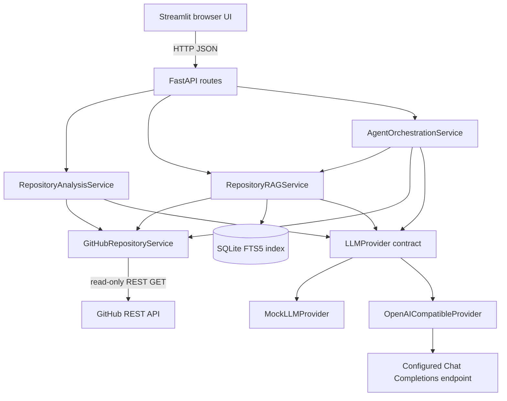

# Architecture and engineering decisions

This document describes the current Phase 1–5A implementation. It is intended to complement, not replace, the source code and API schemas.

## Component boundaries

### FastAPI

`repo_agent.api.main.create_app` composes the repository, analysis, RAG, and agent services. Routes expose health/status and four operations:

- `POST /api/repos/inspect`
- `POST /api/repos/analyze`
- `POST /api/repos/ask`
- `POST /api/repos/agent`

The API translates expected repository, provider, and agent errors into structured, user-safe responses. `/api/status` reports provider mode and agent availability without returning credentials or model configuration.

### Streamlit

The Streamlit client sends HTTP requests to FastAPI; it does not contact GitHub or the model endpoint directly. It displays repository metadata and selected source files, analysis, question/answer history, RAG retrieval details, citations, and agent tool traces. The RAG trace differentiates indexed files, retrieved chunks, and prompt-included chunks. Agent traces expose tool names, sanitized arguments, execution status, and source references, not private prompts or hidden reasoning.

The UI’s backend URL comes from `REPO_AGENT_API_URL` and defaults to `http://127.0.0.1:8000`.

## GitHub retrieval and authentication

`GitHubRepositoryService` validates repository URLs and reads repository metadata, the default branch commit, a recursive tree, and bounded file contents through REST `GET` requests. It filters likely text files and enforces limits for file count, per-file bytes, total bytes, requests, and timeouts. Downloaded repository content is data: it is never executed.

If `GITHUB_TOKEN` is configured, the service sends `Authorization: Bearer …` from the backend. The token is optional for public repositories and is held by the settings system as a secret value. GitHub rate-limit responses are classified separately; `Retry-After` and `X-RateLimit-Reset` are parsed into safe retry guidance. The client avoids automatic retry loops.

The inspector pins every snapshot to a full commit SHA. Git blob SHAs are retained for source identity and citation metadata. GitHub operations remain read-only.

## SQLite FTS5 indexing and retrieval

`RepositoryRAGService` calls `current_revision` before reusing a cached index. Index metadata and chunks are keyed by owner, repository, and commit SHA, so a new default-branch commit receives a separate index. An unchanged commit can reuse the stored FTS index.

`chunk_repository_files` creates overlapping, line-addressable source chunks. Each chunk includes its relative path, one-based inclusive line range, blob SHA, commit SHA, text, and extracted identifiers. `SQLiteFTSIndex` stores source chunks and a corresponding FTS5 virtual table containing path, content, and identifiers. Retrieval is lexical; it does not use an external embedding service.

RAG constructs an evidence context containing metadata and only those chunks that fit the configured prompt budget. It records both the ranked retrieved candidates and the prompt-included subset. This distinction makes it possible to audit when a chunk was found but excluded by context limits.

## Chunk IDs, commits, and citation validation

Stable chunk IDs are derived from the commit SHA, blob SHA, repository path, and original start/end lines. The same evidence range at the same source version therefore resolves consistently; a different commit or blob yields a different identity.

For RAG answers, the provider returns the canonical fields `answer`, `sufficient_context`, and `citation_chunk_ids`. The server accepts IDs only if they belong to chunks actually included in that request’s prompt. For agent answers, IDs must resolve to chunks returned by tools during that agent run. The server derives path, line range, blob/commit metadata, and commit-pinned GitHub URL; it does not trust model-generated URLs or line numbers.

This is a citation-integrity boundary, not a proof of semantic correctness. A model or mock can cite an allowed but irrelevant chunk. Relevance and answer correctness need separate evaluation.

## LLM provider abstraction

`LLMProvider` separates analysis, repository Q&A, and agent turns from service orchestration. `MockLLMProvider` is the default and requires no model key. `OpenAICompatibleProvider` uses the existing `httpx` dependency and a configurable Chat Completions endpoint.

The hosted provider is disabled by default. Remote provider requests require HTTPS and a backend-only `LLM_API_KEY`; local HTTP endpoints are restricted to localhost. Structured JSON response formatting is requested for final answers when supported, with compatibility fallbacks. Provider errors are categorized without logging authorization headers, raw prompts, complete answers, or repository source.

## Native agent tool-calling protocol

`AgentOrchestrationService` owns the agent loop. It sends actual Chat Completions tool schemas and accepts only protocol-level tool calls; ordinary text is never interpreted as an invocation. Each call is validated by a Pydantic model from the strict allowlist:

1. `search_repository(query, path?)`
2. `read_file(path)`
3. `find_symbol(symbol, path?)`
4. `retrieve_chunks(query, paths?)`

The orchestrator appends assistant tool-call messages and matching tool-role results with the returned call IDs. Tool paths are constrained to the inspected repository and commit; tools perform bounded reads/searches only. Tool output and repository files are treated as untrusted input and instructions in them are ignored.

Default limits are five tool-enabled model steps, eight tool calls, an 8,000-token estimated conversation context, five chunks per tool response, and 12,000 characters per tool result. When the step limit is reached and verified evidence fits, the orchestrator permits at most one final-answer-only request with tools disabled. It does not retry finalization indefinitely. Context or evidence exhaustion produces a clear failure/insufficient-evidence result rather than an unsupported answer.

The UI trace contains safe operational metadata and evidence references. It does not reveal hidden reasoning or full private prompts.

## Evaluation architecture

The Phase 5A benchmark lives in `evaluation/benchmark.json` and pins source references to commit `a2da9850fdd1fe8a9bb4ae016a30b3f662f90fa2`. The offline runner reads source from local Git objects, validates expected symbols and line spans, then exercises analysis, RAG, and agent services through a local snapshot adapter and deterministic mock provider. It uses a temporary SQLite database and explicit settings with `.env` loading disabled; it makes no GitHub or OpenAI requests.

Reports are written in JSON, CSV, and Markdown under `evaluation/reports/`. They include commit/configuration provenance, completion and sufficiency, retrieval coverage, citation integrity and mechanical relevance, model/tool calls, chunk duplication, token estimates, and failure/termination categories. Human answer-quality review is separate and is not inferred from mock output.

The optional live mode targets a running FastAPI instance and requires both `--live` and `--approve-paid-api`. It can cause provider charges and read-only GitHub requests. A meaningful live run needs a benchmark whose pinned commit and references match the inspected repository. It is not enabled by default.

## Security boundaries and trade-offs

| Boundary | Control | Trade-off / limitation |
|---|---|---|
| Repository URL and network | Accept GitHub-hosted HTTPS repository URLs; API uses read-only operations | Public repository inspection needs network access and can encounter GitHub limits |
| GitHub credentials | Optional backend `GITHUB_TOKEN`; secret setting; never sent by Streamlit | Public access remains available without a token, with lower unauthenticated quota |
| LLM credentials | Backend-only secret setting; HTTPS for remote endpoints | Hosted inference may cost money and provider behavior varies |
| Repository content | Treated as untrusted data; no code, shell, or generated URL execution | Prompt-injection defenses reduce risk but are not a substitute for reviewing model output |
| Resource usage | File, request, chunk, token/context, step, call, and response-size bounds | Large repositories or broad questions can omit relevant evidence |
| Citations | Server resolves stable IDs to exact source evidence and commit-pinned URLs | Correct provenance does not guarantee a claim is entailed by the cited text |
| Retrieval | SQLite FTS5 indexes paths, source, and identifiers | Lexical search can miss relevant code and cross-module relationships |
| Evaluation | Pinned offline fixtures and mock providers are reproducible | Mock runs test plumbing, not real-model accuracy; human review remains necessary |

## Audited evaluation and known limits

The latest offline run reports 128 passing automated tests, 13/13 mock runs completed, and expected sufficiency matched in 13/13. Citation integrity passed 13/13. Mechanical relevance was 1/1 for analysis, 3/5 applicable RAG cases, and 3/5 applicable agent cases; the no-evidence case is excluded from the relevance denominator.

The audited configuration query did not retrieve `settings.py`. In the agent/RAG relationship case, RAG retrieved the expected symbols but the mock cited unrelated chunks; the agent run also retrieved unrelated ranges. The mock selects early allowed IDs and is not a realistic semantic model. These observations identify retrieval and mock-selection limitations; they do not estimate live-model answer quality. Human-reviewed real-model accuracy has not been measured.

The specific audited mismatches were:

- `configuration-bounds` expected `src/repo_agent/settings.py:9-40` (`Settings`). RAG and agent instead cited `src/repo_agent/github/service.py:196-275`, `261-340`, and `391-470`; neither retrieved the expected settings file. This combines a retrieval miss with the mock’s choice to cite available but unrelated chunks.
- `agent-rag-relationship` expected `src/repo_agent/agent/service.py:206-282` (`AgentOrchestrationService`) and `src/repo_agent/rag/service.py:34-77` (`RepositoryRAGService`). RAG retrieved those symbols but cited `src/repo_agent/agent/service.py:1-80`, `651-730`, and `976-1036`. Agent retrieved only unrelated `agent/service.py` ranges and cited those same ranges. The RAG mismatch is mock citation selection; the agent mismatch includes retrieval and mock-selection misses.

The negative `negative-missing-evidence` case expected no source. Both modes returned no citation and insufficient context. Citation integrity passes for that empty set, while citation relevance is N/A and excluded from the relevance denominator.

Reasonable next evaluation improvements are to tune filename/identifier-aware retrieval against the pinned benchmark, add more cross-module and negative cases, and complete rubric-based human review of a carefully approved live run. No live quality claim should be made until that review exists.
